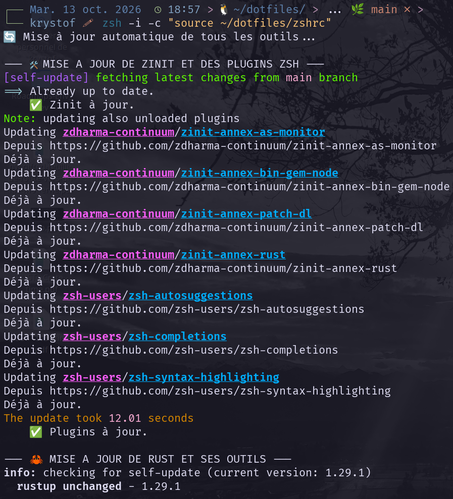

# 🛠️ Dotfiles

Mes fichiers de configuration personnels, pour un environnement de développement en ligne de commande sous **Debian** :

- **[Zsh](https://www.zsh.org/)** modulaire (prompt, alias, plugins [Zinit](https://github.com/zdharma-continuum/zinit), mises à jour hebdomadaires des outils) ;
- **[WezTerm](https://wezterm.org/)** comme terminal, configuré en Lua ;
- **[Git](https://git-scm.com/)** avec **[delta](https://github.com/dandavison/delta)** pour les diffs et **[Lazygit](https://github.com/jesseduffield/lazygit)** comme interface ;
- **[eza](https://github.com/eza-community/eza)** comme remplaçant de `ls`, avec thèmes ;
- un thème commun : **[Rosé Pine](https://rosepinetheme.com/)** (WezTerm, eza, delta, Lazygit).

Ces réglages sont pensés pour fonctionner avec ma configuration de [Neovim](https://neovim.io/) ([NvCrafted](https://github.com/Krystof2so/NvCrafted)), lancée par les fonctions `nvc` (**NvCrafted**), `nvlazy` ([lazy.nvim](https://lazy.folke.io/)) et `nvtest` (une configuration de tests). Voir [Alias et fonctions](#-alias-et-fonctions).



---

## 📁 Structure du dépôt

```
.
├── zshrc                        # Point d'entrée de Zsh (lié à ~/.zshrc)
├── gitconfig                    # Configuration Git globale (lié à ~/.gitconfig)
├── zsh/
│   ├── utils.zsh                # Fonctions utilitaires (needs_global_update, path_prepend, is_installed)
│   ├── env.zsh                  # Options Zsh, locale, PATH, historique, pager
│   ├── plugins.zsh              # Zinit, plugins et complétions
│   ├── prompt.zsh               # Prompt personnalisé (date, heure, venv, état Git)
│   ├── aliases.zsh              # Alias et fonctions
│   └── tools/                   # Mises à jour automatiques (hebdomadaires)
│       ├── zinit.zsh
│       ├── rust.zsh
│       └── python.zsh
├── wezterm/
│   ├── wezterm.lua              # Configuration principale
│   ├── environment.lua          # Détection du shell, de l'éditeur et de la locale
│   ├── keybindings.lua          # Raccourcis clavier
│   ├── wezterm.sh               # Intégration shell de WezTerm (zones sémantiques, cwd)
│   └── themes/
│       ├── theme_rosepine.lua   # Chargement du plugin Rosé Pine (3 variantes)
│       └── toggle_themes.lua    # Bascule entre les variantes
├── delta/
│   └── delta.gitconfig          # Configuration de delta (incluse par gitconfig)
├── lazygit/
│   └── config.yml               # Configuration de Lazygit
├── eza/
│   └── themes/
│       ├── rose-pine.yml        # Variante sombre
│       └── rose-pine-dawn.yml   # Variante claire
├── IMG/
└── README.md
```

---

## 🐚 Zsh

### Ordre de chargement

`zshrc` ne contient aucune configuration : il charge les modules dans cet ordre.

| #   | Fichier           | Rôle                                             |
| --- | ----------------- | ------------------------------------------------ |
| 1   | `zsh/utils.zsh`   | Fonctions utilitaires, à charger en premier      |
| 2   | `fpath+=~/.zfunc` | Dossier de complétions personnelles              |
| 3   | `zsh/env.zsh`     | Environnement de base                            |
| 4   | `zsh/plugins.zsh` | Zinit, plugins, complétions                      |
| 5   | `zsh/prompt.zsh`  | Prompt                                           |
| 6   | `zsh/aliases.zsh` | Alias et fonctions                               |
| 7   | `zsh/tools/*.zsh` | Mises à jour des outils, si le délai est dépassé |

### Fonctions utilitaires (`utils.zsh`)

| Fonction              | Rôle                                                                                            |
| --------------------- | ----------------------------------------------------------------------------------------------- |
| `needs_global_update` | Vrai si la dernière mise à jour date de plus de 7 jours (timestamp dans `~/.zinit-auto-update`) |
| `path_prepend <dir>`  | Ajoute un dossier au début du `PATH` s'il n'y est pas déjà                                      |
| `is_installed <cmd>`  | Vrai si la commande est disponible dans le `PATH`                                               |

### Environnement (`env.zsh`)

- Options de complétion et d'historique (historique partagé entre terminaux, sans doublons, sauvegarde immédiate).
- Locale française : `LANG` et `LC_TIME` à `fr_FR.UTF-8`.
- `PATH` complété avec `~/.local/bin` et `~/.npm-global/bin`.
- `bat` (`batcat`) comme pager et comme `MANPAGER`.

### Plugins (`plugins.zsh`)

Zinit est installé automatiquement au premier lancement s'il est absent. Plugins chargés :

| Plugin                              | Rôle                                          |
| ----------------------------------- | --------------------------------------------- |
| `zsh-users/zsh-completions`         | Complétions supplémentaires                   |
| `zsh-users/zsh-autosuggestions`     | Suggestions à partir de l'historique          |
| `zsh-users/zsh-syntax-highlighting` | Coloration syntaxique de la ligne de commande |

S'y ajoutent quatre annexes Zinit (`as-monitor`, `bin-gem-node`, `patch-dl`, `rust`) et les complétions de `uv` et `uvx`, générées au démarrage.

### Prompt (`prompt.zsh`)

Prompt sur deux lignes, recalculé avant chaque commande, qui affiche :

- la date et l'heure ;
- le répertoire courant ;
- le nom de l'environnement virtuel Python actif ;
- la branche Git, avec `✓` si l'arbre est propre et `✗` s'il y a des modifications.

### Mises à jour automatiques (`zsh/tools/`)

Une fois par semaine, au démarrage d'un shell interactif, `zshrc` exécute :

| Script       | Action                                         |
| ------------ | ---------------------------------------------- |
| `zinit.zsh`  | `zinit self-update` puis `zinit update --all`  |
| `rust.zsh`   | `rustup self update` puis `rustup update`      |
| `python.zsh` | `git pull` de `~/.pyenv` puis `uv self update` |

Le `timestamp` de la dernière exécution est enregistré dans `~/.zinit-auto-update`.

Pour forcer une mise à jour avant la fin du délai supprimer `~/.zinit-auto-update`, puis `source zshrc`

---

## ⚡ Alias et fonctions

Définis dans `zsh/aliases.zsh`.

### Outils en ligne de commande

| Alias                  | Commande                                                    |
| ---------------------- | ----------------------------------------------------------- |
| `ls`                   | `eza` avec icônes, dossiers en premier                      |
| `lsa`                  | `eza` en liste détaillée (état Git, tailles totales, dates) |
| `tree`                 | `eza --tree --icons`                                        |
| `ezadark` / `ezalight` | Bascule le thème eza (Rosé Pine / Rosé Pine Dawn)           |
| `batnp`                | `bat --paging=never`                                        |
| `fd`, `fdf`, `fdd`     | `fdfind` (tout / fichiers / dossiers)                       |
| `grep`                 | `grep --color=auto`                                         |

### Git

| Alias   | Commande     |
| ------- | ------------ |
| `gst`   | `git status` |
| `gdf`   | `git diff`   |
| `glog`  | `git log`    |
| `gcm`   | `git commit` |
| `lazyg` | `lazygit`    |

### Système et paquets

| Commande   | Rôle                                                                                                              |
| ---------- | ----------------------------------------------------------------------------------------------------------------- |
| `apti`     | `sudo aptitude`                                                                                                   |
| `cleanapt` | `sudo aptitude autoclean`                                                                                         |
| `aptiup`   | Met à jour la liste des paquets, puis ouvre `aptitude` seulement s'il y a des mises à jour ou de nouveaux paquets |
| `zinitup`  | Met à jour Zinit et ses plugins à la demande                                                                      |
| `adios`    | `systemctl poweroff`                                                                                              |
| `reboot`   | `systemctl reboot`                                                                                                |

### Langages

| Alias | Commande     |
| ----- | ------------ |
| `pyt` | `python3.14` |
| `lua` | `lua5.5`     |

### Neovim et recherche

| Commande                       | Rôle                                                                     |
| ------------------------------ | ------------------------------------------------------------------------ |
| `nvc`                          | Lance Neovim avec la configuration `nvcrafted` (`NVIM_APPNAME`)          |
| `nvlazy`                       | Lance Neovim avec la configuration `lazyvim`                             |
| `nvtest`                       | Lance Neovim avec la configuration `nvtest`                              |
| `dotfiles`                     | Va dans `~/dotfiles` et l'ouvre avec `nvc`                               |
| `rga <type> <motif> [dossier]` | `ripgrep` limité à un type de fichier, n'affiche que les correspondances |

---

## 🖥️ WezTerm

Configuration en Lua, découpée en modules.

- **Police** : FiraCode Nerd Font Mono, taille 16, ligatures activées.
- **Fenêtre** : 120 × 28 au démarrage, plein écran hors Wayland, opacité de 0,90 au démarrage.
- **Défilement** : 3500 lignes d'historique, barre de défilement activée.
- **Shell et variables** : `environment.lua` choisit `zsh` (sinon `bash`) et `nvim` (sinon `vi`) selon ce qui est installé.
- **Intégration Neovim** : un gestionnaire `user-var-changed` réagit à la variable `ZEN_MODE`, pour l'intégration avec `zen-mode.nvim` (taille de police et barre d'onglets).
- **Intégration shell** : `wezterm.sh` est le script officiel d'intégration de WezTerm (zones sémantiques, répertoire courant, variables utilisateur).

### Thèmes

Le thème [Rosé Pine](https://github.com/neapsix/wezterm) est chargé comme plugin WezTerm, avec ses trois variantes : `RosePineMain` (défaut), `RosePineMoon` et `RosePineDawn`. La bascule règle aussi l'opacité de la fenêtre (0,85 pour Main et Moon, 0,92 pour Dawn) et affiche une notification.

### Raccourcis

| Raccourci                 | Action                                      |
| ------------------------- | ------------------------------------------- |
| `Ctrl` + `Maj` + `Entrée` | Nouveau volet à droite (30 % de la largeur) |
| `Ctrl` + `Maj` + `M`      | Passe à la variante de thème suivante       |

---

## 🔀 Git, delta et Lazygit

### `gitconfig`

- Identité (adresse `noreply` de GitHub) et branche par défaut `main`.
- Éditeur : `nvim` démarrant en mode insertion.
- Gestionnaire d'identifiants : `libsecret`.
- Alias `git lg` : journal avec hash, auteur, date et message sur plusieurs lignes.
- Inclut `delta/delta.gitconfig`.

### `delta/delta.gitconfig`

- `delta` comme pager Git et comme filtre de `git add -p`.
- Affichage côte à côte, navigation `n` / `N` entre les sections, hyperliens.
- Coloration syntaxique avec le thème `rose-pine-moon`.
- Conflits de fusion au format `zdiff3`.

### `lazygit/config.yml`

- Édition des fichiers avec Neovim.
- Confirmation avant de quitter.
- Couleurs Rosé Pine, graphe complet affiché par défaut, polices Nerd Fonts v3.

---

## 📦 Dépendances

| Catégorie                 | Outils                                                            |
| ------------------------- | ----------------------------------------------------------------- |
| Shell                     | `zsh`, `git` (Zinit s'installe tout seul)                         |
| Terminal                  | `wezterm`, police **FiraCode Nerd Font Mono**                     |
| Éditeur                   | `neovim`                                                          |
| Outils CLI                | `eza`, `bat`, `fd-find`, `ripgrep`, `delta`, `lazygit`            |
| Langages et gestionnaires | `rustup`, `pyenv`, `uv`                                           |
| Debian                    | `aptitude`, `libsecret` (pour le gestionnaire d'identifiants Git) |

Sous Debian, `bat` et `fd` s'installent sous les noms `batcat` et `fdfind`, d'où les alias et variables d'environnement correspondants.

---

## 🚀 Installation

```zsh
git clone https://github.com/Krystof2so/dotfiles ~/dotfiles
```

Le dépôt doit se trouver dans `~/dotfiles` : les chemins sont écrits en dur dans les fichiers (`$HOME/dotfiles/...`).

Liens symboliques à créer :

```zsh
ln -sf ~/dotfiles/zshrc    ~/.zshrc
ln -sf ~/dotfiles/gitconfig ~/.gitconfig

mkdir -p ~/.config
ln -sfn ~/dotfiles/wezterm ~/.config/wezterm
ln -sfn ~/dotfiles/lazygit ~/.config/lazygit
```

Pour eza, le thème actif est le lien `~/dotfiles/eza/theme.yml`, créé par les alias `ezadark` et `ezalight`. Il faut donc que eza lise sa configuration dans ce dossier :

```zsh
export EZA_CONFIG_DIR="$HOME/dotfiles/eza"
ezadark   # ou ezalight
```

Puis ouvrir un nouveau shell : Zinit et les plugins s'installent au premier lancement.

---

## ⚠️ Remarques

- `zsh/env.zsh` contient une ligne `CDPATH` avec un chemin d'exemple (`/path/to/other/directory`) à adapter ou à supprimer.
- Les alias `pyt` et `lua` supposent `python3.14` et `lua5.5` installés.
- La configuration est écrite pour **Debian** (`aptitude`, `batcat`, `fdfind`).
